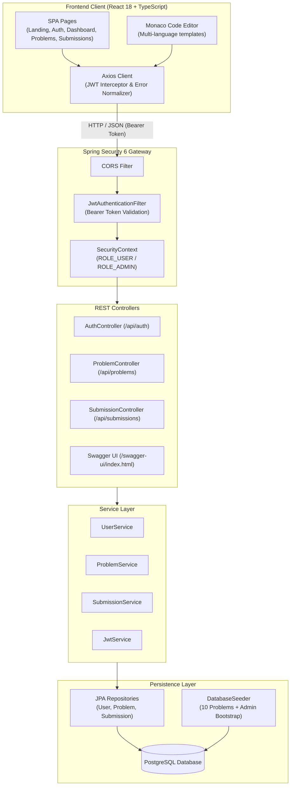

<div align="center">

# CodeArena

**A modern, full-stack online coding assessment platform and algorithmic challenge catalogue.**

[](https://openjdk.org/)
[](https://spring.io/projects/spring-boot)
[](https://spring.io/projects/spring-security)
[](https://react.dev/)
[](https://www.typescriptlang.org/)
[](https://vitejs.dev/)
[](https://tailwindcss.com/)
[](https://www.postgresql.org/)
[](https://swagger.io/)

[Architecture](docs/architecture.md) • [Swagger UI](#api-documentation--swagger-ui) • [Local Setup](#local-setup--quick-start) • [Database Seeding](#database-seeding--admin-bootstrap) • [Testing](#running-automated-tests) • [Roadmap](#future-development-roadmap)

</div>

---

## Overview & Problem Statement

Technical recruitment and algorithmic practice platforms often rely on opaque, tightly coupled architectures that are difficult to inspect, maintain, or self-host. 

**CodeArena** solves this by providing a clean, decoupled, full-stack platform featuring:
- A responsive, single-page client built with **React 18, TypeScript, Tailwind CSS**, and the **Monaco Editor** (the code editor that powers VS Code).
- A robust, stateless **Spring Boot 3** REST API secured with **Spring Security 6** and **HMAC-SHA256 JWT** authentication.
- Relational data persistence with **PostgreSQL** and **Hibernate ORM**, including automated database seeding with 10 foundational algorithm challenges.
- Standardized **RFC 7807 Problem Detail** error formats and interactive **OpenAPI 3 / Swagger UI** documentation.

> [!NOTE]
> **Implementation Scope:** CodeArena currently implements complete problem management, user authentication, role-based authorization, problem exploration, Monaco-powered solution intake, and database seeding. Code submissions are validated and recorded with `PENDING` status. Isolated sandboxed code execution is scheduled for the next development milestone (see [Current Limitations](#current-limitations) and [Roadmap](#future-development-roadmap)).

---

## Key Implemented Features

### 1. User Authentication & Role-Based Access Control (RBAC)
- **Stateless JWT Security:** Standard `Authorization: Bearer <token>` authentication with configurable expiration.
- **Secure Password Storage:** Industry-standard password hashing using `BCryptPasswordEncoder`.
- **Granular Permissions:** Two distinct roles (`ROLE_USER` and `ROLE_ADMIN`) with method-level authorization.
- **Token Management:** Client-side Axios interceptor automatically attaches tokens and handles token expiration / 401 redirections.
- **User Profile API:** Dedicated `/api/auth/me` endpoint to verify authentication state and retrieve user details.

### 2. Algorithmic Problem Management & Discovery
- **Public Problem Browsing:** Unauthenticated guests can search, filter, and inspect coding challenges.
- **Dynamic Search & Filtering:** Case-insensitive search across problem titles and descriptions; filtering by difficulty (`EASY`, `MEDIUM`, `HARD`).
- **Pagination & Sorting:** Configurable page size and sorting by creation timestamp, title, or difficulty.
- **Information Protection:** Public problem endpoints serve examples while strictly concealing hidden evaluation test cases (`isHidden = true`).
- **Admin Problem Authoring:** Administrators can create, update, and delete coding problems with cascading test cases and examples.

### 3. In-Browser Code Editor (Monaco Editor)
- **VS Code Engine:** Embedded `@monaco-editor/react` editor in dark theme (`vs-dark`).
- **Multi-Language Support:** Starter code templates and syntax highlighting for **Java**, **Python**, **C++**, **JavaScript**, **Go**, and **Rust**.
- **Editor Ergonomics:** Line numbers, mini-map, tab indentation, and responsive split-pane layout.

### 4. Solution Submission Intake
- **Authenticated Submissions:** Registered candidates can submit solutions with source code and chosen language.
- **Audit & Status Tracking:** Submissions are persisted in PostgreSQL with initial `PENDING` status, recording problem ID, user ID, language, source code, and timestamp.
- **Ownership Enforcement:** Candidates can inspect their own submission history (`/api/submissions/my` and `/api/submissions/{id}`). Unauthorized access attempts return HTTP 403 Forbidden.

### 5. Automated Database Seeding & Admin Bootstrap
- **Idempotent Data Seeder:** On startup, `DatabaseSeeder` inserts 10 foundational algorithm problems covering:
  - *Arrays, Strings, Hash Maps, Binary Search, Two Pointers, Sliding Window, Stack, and Recursion.*
- **Admin Bootstrapping:** Safely creates an initial administrator account from environment variables (`ADMIN_USERNAME`, `ADMIN_EMAIL`, `ADMIN_PASSWORD`) without storing credentials in source control.

### 6. Developer Experience & API Documentation
- **Interactive Swagger UI:** Test endpoints directly via browser at `/swagger-ui/index.html` with Bearer token authentication support.
- **RFC 7807 Problem Details:** Unified JSON error structures for validation errors (400), authentication failures (401), access denial (403), and missing resources (404).
- **CORS Configured:** Pre-configured for local frontend development (`localhost:5173`, `localhost:3000`).

---

## Technology Stack

| Category | Technologies |
| :--- | :--- |
| **Frontend** | React 18, TypeScript 5, Vite 5, Tailwind CSS 3, React Router v6, Axios, Monaco Editor (`@monaco-editor/react`), Lucide React |
| **Frontend Testing** | Vitest, React Testing Library, JSDOM |
| **Backend** | Java 17, Spring Boot 3.3.5 (Spring MVC, Spring Data JPA, Spring Security 6, Spring Validation) |
| **Token Security** | Java JWT (`jjwt` 0.12.6, HMAC-SHA256) |
| **Database** | PostgreSQL 14+ (Local/Persistent), H2 Database (In-Memory Testing) |
| **API Documentation**| SpringDoc OpenAPI 3 / Swagger UI (`springdoc-openapi-starter-webmvc-ui` 2.6.0) |
| **Build & Tooling** | Apache Maven 3.8+, Node.js 18+, npm 9+ |
| **Backend Testing** | JUnit 5, Mockito, AssertJ, Spring Boot Test (`MockMvc`) |

---

## System Architecture



> For deep-dive sequence diagrams, authorization rules, and data models, see [Architecture & System Design](docs/architecture.md).

---

## Visual Previews

| View | Preview |
| :--- | :--- |
| **Landing Page** | Explore the platform, view features, and navigate to the problem catalogue. <br/>*(See `docs/screenshots/landing.png`)* |
| **Problem Explorer** | Filter challenges by difficulty (`EASY`, `MEDIUM`, `HARD`), search in real-time, and view pagination controls. <br/>*(See `docs/screenshots/problems.png`)* |
| **Monaco Code Editor** | Split-pane challenge view with full problem description, test examples, language selector, and code editor. <br/>*(See `docs/screenshots/problem-detail.png`)* |
| **User Dashboard** | High-level candidate stats, role indicators, and quick links to practice challenges. <br/>*(See `docs/screenshots/dashboard.png`)* |
| **Submission History** | Review submitted solutions, target problem, programming language, timestamp, and intake status. <br/>*(See `docs/screenshots/submissions.png`)* |

> [!TIP]
> To capture or update visual screenshots locally, follow the step-by-step [Screenshot Capture Guide](docs/screenshots/README.md).

---

## Project Structure

```text
codearena/
├── pom.xml                                      # Maven dependencies and build configuration
├── .gitignore                                   # Ignore rules for build artifacts, node_modules & credentials
├── application.properties.example               # Root configuration template with safe placeholders
├── README.md                                    # Project documentation
│
├── docs/                                        # Architecture and documentation
│   ├── architecture.md                          # Detailed architectural design and sequence diagrams
│   └── screenshots/                             # Visual previews and capture guide
│       └── README.md
│
├── frontend/                                    # React + TypeScript single-page application
│   ├── package.json                             # Frontend dependencies and scripts
│   ├── vite.config.ts                           # Vite configuration and backend API proxy
│   ├── tailwind.config.js                       # Tailwind CSS styling configuration
│   ├── tsconfig.json                            # TypeScript compiler configuration
│   ├── .env.example                             # Frontend environment template
│   └── src/
│       ├── api/                                 # Axios client and API service modules
│       │   ├── client.ts                        # Axios instance with JWT interceptor & error parsing
│       │   ├── auth.ts                          # Registration, login, profile APIs
│       │   ├── problems.ts                      # Problem querying & detail retrieval
│       │   └── submissions.ts                   # Submission intake & user history
│       ├── components/                          # Reusable UI components
│       │   ├── common/                          # Navbar, Footer, Button, Card, Badge, LoadingSpinner
│       │   ├── problem/                         # CodeEditor, ProblemCard, ProblemFilter
│       │   └── submission/                      # SubmissionRow
│       ├── context/                             # React Context (AuthContext)
│       ├── pages/                               # Page routes (Landing, Auth, Dashboard, Problems, etc.)
│       ├── types/                               # TypeScript interfaces and contracts
│       └── test/                                # Frontend test suite (Vitest + RTL)
│
└── src/                                         # Spring Boot backend application
    ├── main/
    │   ├── java/com/codearena/
    │   │   ├── CodeArenaApplication.java        # Spring Boot entry point
    │   │   ├── config/                          # Security, JWT, OpenAPI & Database Seeder
    │   │   │   ├── DatabaseSeeder.java          # 10 problems + Admin bootstrap runner
    │   │   │   ├── JwtAuthenticationFilter.java # Bearer token verification filter
    │   │   │   ├── OpenApiConfig.java           # Swagger / OpenAPI 3 configuration
    │   │   │   └── SecurityConfig.java          # SecurityFilterChain and CORS definition
    │   │   ├── controller/                      # REST controllers (Auth, Problem, Submission)
    │   │   ├── dto/                             # Request and response transfer objects
    │   │   ├── entity/                          # JPA entities (User, Problem, Example, TestCase, Submission)
    │   │   ├── exception/                       # Custom exceptions & RFC 7807 GlobalExceptionHandler
    │   │   ├── repository/                      # Spring Data JPA repositories and Specifications
    │   │   └── service/                         # Business logic services and implementations
    │   └── resources/
    │       ├── application.properties           # Spring configuration reading environment variables
    │       └── application.properties.example   # Safe placeholder template
    └── test/                                    # Backend automated test suite
        ├── java/com/codearena/                  # JUnit 5 & Mockito tests (54 passing tests)
        └── resources/application-test.properties# In-memory H2 test configuration
```

---

## Prerequisites

Before running CodeArena locally, verify you have the following installed:

- **Java Development Kit (JDK):** Version 17 or higher (`java -version`)
- **Apache Maven:** Version 3.8+ (`mvn -version`)
- **Node.js:** Version 18.x or higher (`node -v`)
- **npm:** Version 9.x or higher (`npm -v`)
- **PostgreSQL:** Version 14 or higher running locally or in a container (`psql --version`)

---

## Local Setup & Quick Start

### 1. Clone the Repository
```bash
git clone https://github.com/vidushitripa4thi/codearena.git
cd codearena
```

### 2. Configure the PostgreSQL Database
Connect to your local PostgreSQL instance and create the database:
```sql
CREATE DATABASE codearena;
```

### 3. Environment Variables Configuration

CodeArena uses environment variables to inject sensitive credentials without committing them to source control.

| Variable | Description | Default (if unset) | Required |
| :--- | :--- | :--- | :--- |
| `DB_URL` | PostgreSQL JDBC connection URL | `jdbc:postgresql://localhost:5432/codearena` | No |
| `DB_USERNAME` | PostgreSQL username | `postgres` | No |
| `DB_PASSWORD` | PostgreSQL password | *(empty)* | **Yes** |
| `JWT_SECRET` | HMAC-SHA256 secret (>= 32 chars) | *(empty)* | **Yes** |
| `JWT_EXPIRATION_MINUTES` | Token validity in minutes | `60` | No |
| `SEED_DATA` | Automatically seed 10 problems on startup | `true` | No |
| `ADMIN_USERNAME` | Username for bootstrap admin | *(empty)* | Optional |
| `ADMIN_EMAIL` | Email for bootstrap admin | *(empty)* | Optional |
| `ADMIN_PASSWORD` | Password for bootstrap admin | *(empty)* | Optional |
| `VITE_API_BASE_URL` | Frontend API base route | `/api` | No |

#### Setting Environment Variables on Windows (PowerShell):
```powershell
$env:DB_URL="jdbc:postgresql://localhost:5432/codearena"
$env:DB_USERNAME="postgres"
$env:DB_PASSWORD="your_postgres_password"
$env:JWT_SECRET="codearena-jwt-secret-key-that-is-at-least-256-bits-long-32-bytes"
$env:JWT_EXPIRATION_MINUTES="60"
$env:SEED_DATA="true"
$env:ADMIN_USERNAME="admin"
$env:ADMIN_EMAIL="admin@codearena.com"
$env:ADMIN_PASSWORD="AdminPassword123!"
```

*(On Linux / macOS, use standard `export VARIABLE="value"` syntax).*

---

## Running the Application

### 1. Start the Spring Boot Backend
From the project root:
```bash
mvn spring-boot:run
```
The backend initializes, runs `DatabaseSeeder`, and listens on **`http://localhost:8080`**.

### 2. Start the React Frontend
In a separate terminal, navigate to the `frontend/` directory, install dependencies, and launch Vite:
```bash
cd frontend
npm install
npm run dev
```
Open **`http://localhost:5173`** in your browser. The Vite development server automatically proxies `/api` requests to `http://localhost:8080`.

---

## API Documentation & Swagger UI

CodeArena provides interactive OpenAPI 3 documentation powered by SpringDoc:

- **Swagger UI (Interactive Playground):** [`http://localhost:8080/swagger-ui/index.html`](http://localhost:8080/swagger-ui/index.html)
- **Raw OpenAPI JSON Docs:** [`http://localhost:8080/v3/api-docs`](http://localhost:8080/v3/api-docs)

### Authorizing in Swagger UI:
1. Log in via `POST /api/auth/login` or register via `POST /api/auth/register`.
2. Copy the `token` string from the JSON response.
3. Click the green **Authorize** button at the top of Swagger UI.
4. Paste the token into the value field and submit. All protected endpoints can now be executed directly from the browser!

---

## Database Seeding & Admin Bootstrap

When `app.seed.enabled=true` (the default), `DatabaseSeeder` inspects the database on application startup. If the problem table is empty, it automatically seeds 10 algorithmic problems:

| # | Problem Title | Difficulty | Algorithmic Category |
| :-: | :--- | :--- | :--- |
| 1 | **Two Sum** | `EASY` | Hash Maps / Arrays |
| 2 | **Valid Palindrome** | `EASY` | Two Pointers / Strings |
| 3 | **Longest Substring Without Repeating Characters** | `MEDIUM` | Sliding Window / Hash Set |
| 4 | **Valid Parentheses** | `EASY` | Stack |
| 5 | **Search in Rotated Sorted Array** | `MEDIUM` | Binary Search |
| 6 | **Maximum Subarray (Kadane's Algorithm)** | `MEDIUM` | Dynamic Programming / Arrays |
| 7 | **Container With Most Water** | `MEDIUM` | Two Pointers / Greedy |
| 8 | **Merge Two Sorted Lists** | `EASY` | Linked Lists / Two Pointers |
| 9 | **Subsets** | `MEDIUM` | Backtracking / Recursion |
| 10 | **Climbing Stairs** | `EASY` | Dynamic Programming / Recursion |

### Bootstrap Admin Account:
To create an initial administrative user on launch, provide the three admin environment variables:
```powershell
$env:ADMIN_USERNAME="admin"
$env:ADMIN_EMAIL="admin@codearena.com"
$env:ADMIN_PASSWORD="AdminPassword123!"
```
If an account with that username already exists, the seeder safely skips creation.

---

## Running Automated Tests

CodeArena includes comprehensive automated test suites for both backend and frontend.

### Backend Tests (JUnit 5, Mockito, MockMvc)
Backend integration tests run against an **isolated in-memory H2 database**. No PostgreSQL instance is required to run tests.

Run all unit and integration tests:
```bash
mvn test
```

Run complete build verification:
```bash
mvn clean verify
```
*(All 54 tests pass with `BUILD SUCCESS` across security, controllers, services, repositories, and seeder).*

### Frontend Tests (Vitest & React Testing Library)
Navigate to the `frontend/` directory and run:
```bash
cd frontend
npm test
```

Verify frontend production build and TypeScript compilation:
```bash
npm run build
```
*(All 17 tests pass with zero TypeScript errors).*

---

## Current Limitations

To maintain absolute transparency with recruiters and developers, here is what is intentionally **not** yet implemented in the current milestone:

1. **Online Judge Code Execution:** Submitted code is validated and stored in PostgreSQL with `status = PENDING`. The application does not compile or run user code on the host machine. Running untrusted code on a host server poses severe security risks; execution is reserved for an isolated containerized worker service.
2. **Asynchronous Message Queue:** Submissions are persisted directly in the relational database rather than published to a message broker (RabbitMQ / Kafka).
3. **Real-time Live Verdicts:** The client does not use WebSockets for real-time status updates; submission receipts display the current persisted status.
4. **Cloud / Infrastructure Orchestration:** The project currently runs in local development mode; Docker Compose, Kubernetes manifests, and cloud deployment pipelines are planned for Milestone 4.

---

## Future Development Roadmap

- [ ] **Milestone 3 — Sandboxed Code Execution Worker:**
  - Decoupled worker service consuming submission tasks from a message queue (RabbitMQ / Redis Streams).
  - Sandboxed compiler and runtime utilizing isolated Linux containers / microVMs (Docker / gVisor).
  - Strict resource constraints (CPU execution limits, memory isolation, process count restrictions).
  - Automated output verification comparing stdout against hidden test cases.
- [ ] **Milestone 4 — Real-Time Verdicts & WebSockets:**
  - WebSocket / SSE push notifications updating candidates from `PENDING` → `RUNNING` → `ACCEPTED` / `WRONG_ANSWER` / `TIME_LIMIT_EXCEEDED`.
- [ ] **Milestone 5 — Contests, Leaderboards & Social:**
  - Scheduled coding contests with live countdown timers and penalty point scoring.
  - Global user leaderboards and rating progression.
- [ ] **Milestone 6 — Production Containerization & CI/CD:**
  - Multi-stage `Dockerfile` and `docker-compose.yml` for unified one-command local orchestration.
  - GitHub Actions CI/CD workflow running automated unit and integration tests on pull requests.

---

## Contributing & Security

1. **Security First:** Never commit `.env` files, production credentials, or real secret keys to source control.
2. **Verification:** Always run `mvn clean verify` and `npm test` before submitting changes.
3. **Code Style:** Keep backend controllers thin, encapsulate logic in services, and maintain DTO isolation.

---

## License

This project is licensed under the [MIT License](LICENSE).
