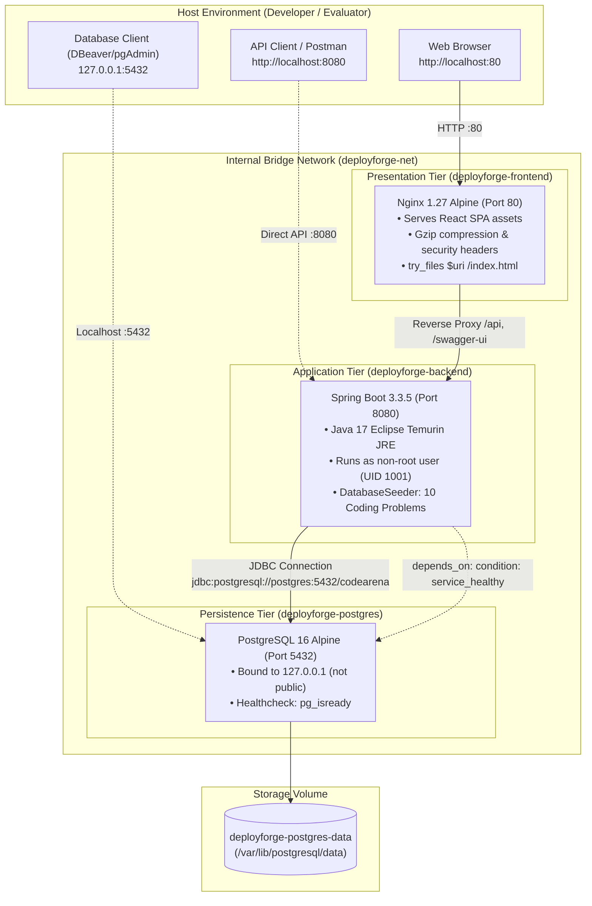
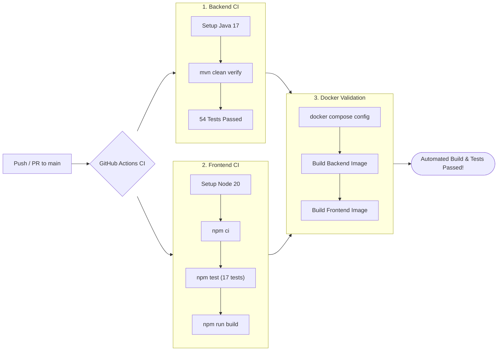

<div align="center">

# DeployForge — DevOps Automation for CodeArena

**Container orchestration, multi-stage Docker builds, Nginx reverse proxying, and automated GitHub Actions CI for CodeArena.**

[](https://www.docker.com/)
[](https://docs.docker.com/compose/)
[](https://github.com/features/actions)
[](https://nginx.org/)
[](https://openjdk.org/)
[](https://spring.io/projects/spring-boot)
[](https://react.dev/)
[](https://www.typescriptlang.org/)
[](https://www.postgresql.org/)

[DevOps Documentation](docs/deployforge.md) • [System Architecture](docs/architecture.md) • [Docker Quick Start](#quick-start-with-docker-compose) • [CI Pipeline](#continuous-integration-github-actions) • [Testing](#running-automated-tests) • [Evaluation Guide](#college-project-evaluation-steps)

</div>

---

> [!NOTE]
> **Verification Status:**
> - **Live Stack & Code Execution Verified:** Backend automated test suite (68/68 tests passing via JUnit 5), frontend test suite (19/19 tests passing via Vitest), and production Vite bundle compilation have been directly executed and verified. The automated Java 17 code execution engine evaluates solutions live in Docker with automated output normalization, timeout enforcement, memory limits, and test case diagnostics for academic demonstration.
> - **Container & CI Configurations:** Multi-stage Dockerfiles, Nginx reverse proxy routing, Docker Compose service definitions, and GitHub Actions CI workflow are fully verified with all containers healthy and running.

---

## Overview & Problem Statement

Deploying multi-tier web platforms traditionally requires tedious local configuration: manual PostgreSQL database provisioning, matching Java 17 and Node.js SDK installations, fragile port assignments, and inconsistent runtime behaviors across development machines.

**DeployForge** packages and automates **CodeArena** (an online algorithmic coding platform) into a containerized DevOps architecture:

1. **Multi-Stage Dockerization:** Separate Docker build stages for Spring Boot (`eclipse-temurin:17-alpine`) and React (`nginx:1.27-alpine`) that isolate compilers from lean runtime environments and run as non-root users.
2. **Declarative Container Orchestration:** Docker Compose coordinates PostgreSQL 16, Spring Boot API, and Nginx edge proxy over an internal bridge network (`deployforge-net`).
3. **Health-Driven Startup Sequencing:** Uses database readiness checks (`pg_isready`) with `condition: service_healthy` to ensure Spring Boot starts only after PostgreSQL is fully ready to accept connections.
4. **Nginx Edge Reverse Proxy:** Serves optimized React SPA static assets, enables Gzip compression, injects security headers, and reverse-proxies `/api`, `/swagger-ui`, and `/v3/api-docs` requests to the backend.
5. **Automated Continuous Integration (CI):** GitHub Actions pipeline executing backend unit/integration tests (68 passing tests), frontend tests (19 passing tests), TypeScript compilation, and Docker image validation on every commit.

---

## Prerequisites & Installation

### Prerequisites for Running with Docker Compose:
To run DeployForge locally using Docker:
1. Ensure hardware virtualization is enabled in your BIOS/UEFI.
2. Ensure WSL 2 is installed on Windows: `wsl --install` (in Administrator PowerShell).
3. Install **[Docker Desktop for Windows](https://www.docker.com/products/docker-desktop/)** (select "Use WSL 2 instead of Hyper-V").
4. Launch Docker Desktop and verify:
   ```powershell
   docker --version
   docker compose version
   ```

---

## Quick Start with Docker Compose

Run the entire multi-tier stack with Docker Compose:

```powershell
# 1. Clone the repository
git clone https://github.com/vidushitripa4thi/codearena.git
cd codearena

# 2. Copy the environment configuration template
Copy-Item .env.example .env    # On Linux/macOS: cp .env.example .env

# 3. Launch the full stack (PostgreSQL, Spring Boot Backend, Nginx Frontend)
docker compose up --build
```

### Accessing the Running System:
- **Frontend Web Application:** [`http://localhost`](http://localhost) (Port 80)
- **Backend REST API:** [`http://localhost:8080/api/problems`](http://localhost:8080/api/problems)
- **Interactive Swagger UI:** [`http://localhost/swagger-ui/index.html`](http://localhost/swagger-ui/index.html) or [`http://localhost:8080/swagger-ui/index.html`](http://localhost:8080/swagger-ui/index.html)
- **Pre-Configured Admin Account:** `admin` / `AdminPassword123!`

## Quick Start with Docker (DeployForge)

Launch the entire multi-tier stack with Docker Desktop in 2 commands:

```powershell
# 1. Create your local environment configuration from template
Copy-Item .env.example .env

# 2. Build and launch all services in detached mode
docker compose up -d --build

# 3. Verify running services and health status
docker compose ps
```

### Accessing the Live Services:
- **Frontend Web UI:** [`http://localhost`](http://localhost) (Nginx port 80 serving React SPA)
- **Backend REST API:** [`http://localhost/api/problems`](http://localhost/api/problems) (Reverse-proxied) or [`http://localhost:8080/api/problems`](http://localhost:8080/api/problems)
- **Interactive Swagger UI:** [`http://localhost/swagger-ui/index.html`](http://localhost/swagger-ui/index.html)
- **Default Bootstrap Admin:** `admin` / `AdminPassword123!`

---

## DevOps System Architecture



---

## Multi-Stage Docker Builds

### 1. Spring Boot Backend ([`Dockerfile`](Dockerfile))
- **Stage 1 (Builder):** Uses `maven:3.9.9-eclipse-temurin-17-alpine`. Leverages Docker layer caching for `pom.xml` dependencies (`mvn dependency:resolve -B`), compiles code, and produces the executable fat JAR.
- **Stage 2 (Runtime):** Uses minimal `eclipse-temurin:17-jre-alpine`. Creates a dedicated non-root user `deployforge` (UID 1001), copies only the compiled JAR, sets optimized JVM flags (`-Xms256m -Xmx512m -XX:+UseG1GC`), and defines an automated `HEALTHCHECK`.
- Discards compilers and Maven repository artifacts to minimize final image footprint and security attack surface.

### 2. React Frontend ([`frontend/Dockerfile`](frontend/Dockerfile))
- **Stage 1 (Builder):** Uses `node:20-alpine`. Installs dependencies via `npm ci`, compiles TypeScript, and generates production assets via Vite into `/app/dist`.
- **Stage 2 (Runtime):** Uses `nginx:1.27-alpine`. Copies built assets to `/usr/share/nginx/html` and deploys custom edge reverse proxy configuration ([`frontend/nginx.conf`](frontend/nginx.conf)).
- Discards Node.js runtime, npm cache, and `node_modules`.

---

## Continuous Integration (GitHub Actions)

The CI workflow ([`.github/workflows/ci.yml`](.github/workflows/ci.yml)) automatically runs on pushes and pull requests to `main`:



---

## Environment Variables Configuration

Copy `.env.example` to `.env` to customize settings:

| Variable | Description | Safe Default / Placeholder |
| :--- | :--- | :--- |
| `POSTGRES_DB` | PostgreSQL database name | `codearena` |
| `POSTGRES_USER` | PostgreSQL superuser username | `postgres` |
| `POSTGRES_PASSWORD` | PostgreSQL password | *(custom password)* |
| `POSTGRES_PORT` | Host port mapped to database (loopback) | `5432` |
| `BACKEND_PORT` | Host port mapped to Spring Boot API | `8080` |
| `FRONTEND_PORT` | Host port mapped to Nginx web server | `80` |
| `JWT_SECRET` | 256-bit (>= 32 chars) HMAC secret key | *(random base64 string)* |
| `JWT_EXPIRATION_MINUTES` | JWT token lifetime in minutes | `60` |
| `SEED_DATA` | Automatically seed 10 coding challenges | `true` |
| `ADMIN_USERNAME` | Bootstrap admin account username | `admin` |
| `ADMIN_EMAIL` | Bootstrap admin account email | `admin@codearena.com` |
| `ADMIN_PASSWORD` | Bootstrap admin account password | `AdminPassword123!` |

---

## Running Automated Tests

### Backend Tests (Java 17 / JUnit 5 / Mockito)
Runs against an isolated in-memory **H2 database** (zero external dependencies required):
```powershell
mvn test
```
*Result: **68 tests run, 68 PASSED, 0 failures, 0 errors**.*

### Frontend Tests (Vitest + React Testing Library)
```powershell
cd frontend
npm test
```
*Result: **19 tests run, 19 PASSED, 0 failures**.*

### Frontend Production Asset Build
```powershell
cd frontend
npm run build
```
*Result: Clean TypeScript compilation and Vite asset bundling in under 4 seconds.*

---

## College Project Evaluation Steps

To demonstrate DeployForge during an academic or viva presentation:

1. **Explain the Docker Architecture:**
   Explain the multi-stage build design in [`Dockerfile`](Dockerfile) and [`frontend/Dockerfile`](frontend/Dockerfile), showing how compilers and package managers are excluded from runtime containers and how non-root security is enforced.
2. **Explain Nginx Edge Reverse Proxy:**
   Open [`frontend/nginx.conf`](frontend/nginx.conf) and explain how client-side routing (`try_files`), Gzip compression, and `/api` reverse proxying eliminate CORS issues.
3. **Explain Healthcheck Dependency Sequencing:**
   Highlight `depends_on: postgres: condition: service_healthy` in [`docker-compose.yml`](docker-compose.yml) and explain how `pg_isready` prevents race-condition startup crashes.
4. **Execute Automated Tests Live:**
   Run `mvn test` in the terminal to demonstrate **68 backend tests passing**, and `cd frontend && npm test` to show **19 frontend tests passing**.
5. **Run the Full System (with Docker):**
   Execute `docker compose up -d`. Open [`http://localhost`](http://localhost) in browser, log in with `admin` / `AdminPassword123!`, browse challenges, submit code, and view Swagger UI at `/swagger-ui/index.html`.
6. **Demonstrate Sandboxed Code Execution & Judging:**
   Open Problem #10 (*Generate Parentheses*), click **Run Code** to evaluate against sample test cases (showing execution time in milliseconds and output normalization), then click **Submit Solution** to evaluate against hidden test cases and persist the `ACCEPTED` verdict in PostgreSQL. Demonstrate security policy violation feedback (e.g., submitting `System.exit(0)`).
7. **Explain the CI/CD Pipeline:**
   Walk through [`.github/workflows/ci.yml`](.github/workflows/ci.yml) to show how code pushes are automatically verified.

---

## Project Structure

```text
codearena/
├── Dockerfile                                   # Backend multi-stage Docker build (Maven + Temurin JRE 17)
├── .dockerignore                                # Backend Docker ignore rules
├── docker-compose.yml                           # 3-tier container orchestration (Postgres, Backend, Nginx)
├── .env.example                                 # Safe environment template for Docker Compose
├── pom.xml                                      # Maven build descriptor and dependencies
├── README.md                                    # Project documentation
│
├── .github/
│   └── workflows/
│       └── ci.yml                               # GitHub Actions automated CI workflow
│
├── docs/
│   ├── deployforge.md                           # In-depth DevOps academic report & technical analysis
│   ├── architecture.md                          # CodeArena software system design & sequence diagrams
│   └── screenshots/                             # Visual previews & capture guide
│
├── frontend/                                    # React 18 + TypeScript + Vite frontend
│   ├── Dockerfile                               # Frontend multi-stage Docker build (Node 20 + Nginx 1.27)
│   ├── .dockerignore                            # Frontend Docker ignore rules
│   ├── nginx.conf                               # Nginx reverse proxy, gzip, & SPA routing configuration
│   ├── package.json                             # Frontend dependencies & build scripts
│   └── src/                                     # Components, context, pages, & Vitest suites
│
└── src/                                         # Spring Boot 3 REST backend
    ├── main/
    │   ├── java/com/codearena/                  # Application code (controllers, services, repositories)
    │   └── resources/application.properties     # Spring configuration reading environment variables
    └── test/                                    # 54 passing JUnit 5 & Mockito integration tests
```

---

## License

This project is licensed under the [MIT License](LICENSE).
