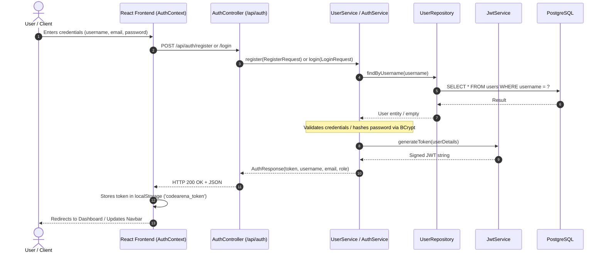
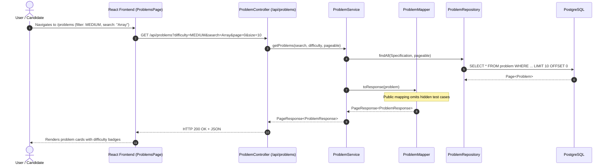
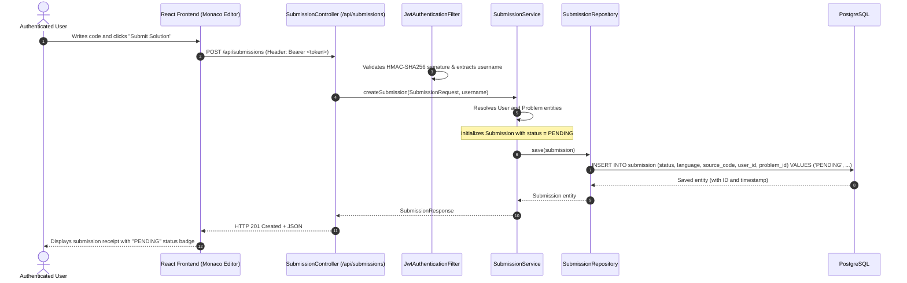
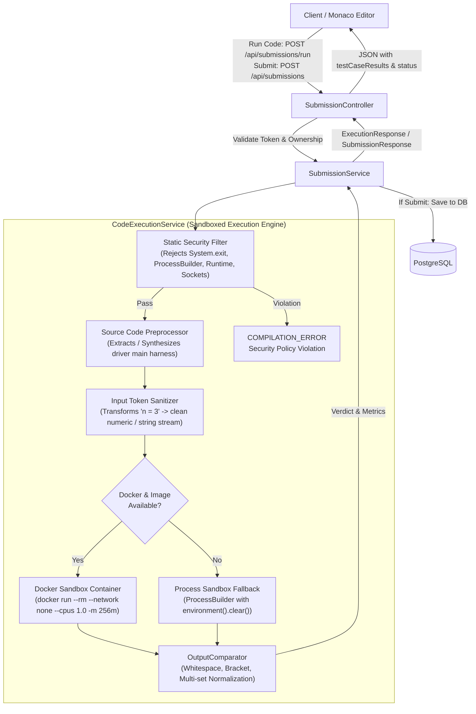

# CodeArena — Architecture & System Design Documentation

This document describes the architectural design, component interactions, security model, and data flow of **CodeArena**, a full-stack algorithmic coding platform.

---

## 1. High-Level System Architecture

CodeArena follows a modern **layered, decoupled client-server architecture**:
- **Client Tier:** A single-page application (SPA) built with React, TypeScript, Vite, and Tailwind CSS.
- **API & Security Gateway Tier:** Spring Boot 3 REST API secured with Spring Security 6 and stateless JSON Web Tokens (JWT).
- **Service & Business Tier:** Transactional Spring services orchestrating business rules, DTO mapping, and domain logic.
- **Persistence Tier:** Spring Data JPA with Hibernate ORM backed by PostgreSQL for persistent production data and H2 for isolated automated testing.

```mermaid
flowchart TD
    subgraph Client["Frontend Client (React 18 + TypeScript)"]
        UI["UI Pages & Components<br/>(Dashboard, Problems, Monaco Editor, Submissions)"]
        AxiosClient["Axios API Client<br/>(JWT Interceptor & Error Normalization)"]
        AuthCtx["AuthContext & LocalStorage<br/>(Session & Token Management)"]
        UI --> AxiosClient
        AuthCtx -. Token injection .-> AxiosClient
    end

    subgraph Gateway["API & Security Layer (Spring Boot 3)"]
        CORS["CORS Filter<br/>(Allowed Origins: localhost:*)"]
        SecurityFilterChain["Spring Security 6 FilterChain<br/>(CSRF Disabled, Stateless Session)"]
        JwtFilter["JwtAuthenticationFilter<br/>(Extracts & Validates HMAC-SHA256 Token)"]
        CORS --> SecurityFilterChain --> JwtFilter
    end

    subgraph Controllers["REST Controller Layer"]
        AuthController["AuthController<br/>/api/auth/*"]
        ProblemController["ProblemController<br/>/api/problems/*"]
        SubmissionController["SubmissionController<br/>/api/submissions/*"]
        SwaggerDocs["Swagger / OpenAPI<br/>/swagger-ui/index.html<br/>/v3/api-docs"]
        GlobalException["GlobalExceptionHandler<br/>(RFC 7807 ProblemDetail)"]
    end

    subgraph Services["Service & Business Logic Tier"]
        UserService["UserService / UserServiceImpl<br/>(BCrypt hashing, User lookup)"]
        ProblemService["ProblemService / ProblemServiceImpl<br/>(JPA Specification querying, CRUD)"]
        SubmissionService["SubmissionService / SubmissionServiceImpl<br/>(Intake validation, ownership checks)"]
        JwtService["JwtService<br/>(Token generation & signature verification)"]
        Mapper["ProblemMapper<br/>(Entity <-> DTO conversion, hides hidden test cases)"]
    end

    subgraph Persistence["Persistence & Database Tier"]
        UserRepository["UserRepository"]
        ProblemRepository["ProblemRepository"]
        SubmissionRepository["SubmissionRepository"]
        Seeder["DatabaseSeeder<br/>(Idempotent seeding & Admin bootstrap)"]
        PostgresDB[("PostgreSQL Database<br/>(users, problem, example, test_case, submission)")]
    end

    AxiosClient -->|"HTTP Requests (JSON / Bearer Token)"| CORS
    JwtFilter --> Controllers
    Controllers --> Services
    Services --> Persistence
    UserRepository --> PostgresDB
    ProblemRepository --> PostgresDB
    SubmissionRepository --> PostgresDB
    Seeder --> PostgresDB
```



---

## 2. Component Breakdown

### 2.1 Frontend Client Layer (`frontend/`)

- **Routing & Navigation (`react-router-dom`):**
  - Public routes: `/` (Landing), `/login` (Login), `/register` (Sign Up), `/problems` (Problems list), `/problems/:id` (Problem details).
  - Protected routes (`ProtectedRoute`): `/dashboard` (User dashboard), `/submissions` (Submission history).
- **Interactive Code Editor (`@monaco-editor/react`):**
  - Embeds the VS Code-grade Monaco Editor.
  - Multi-language syntax highlighting and starter code templates for Java, Python, C++, JavaScript, Go, and Rust.
  - Editor settings (tab size, line numbers, mini-map, dark theme `vs-dark`).
- **Axios API Client (`frontend/src/api/client.ts`):**
  - **Request Interceptor:** Automatically reads the active token from `localStorage` (`codearena_token`) and injects the HTTP header:
    ```http
    Authorization: Bearer <jwt-token>
    ```
  - **Response Interceptor:** Gracefully captures `401 Unauthorized` responses, clears stale authentication tokens, and redirects the client to `/login`.
  - **RFC 7807 Parsing:** Normalizes backend `ProblemDetail` payloads (`status`, `detail`, `errors`, `title`) into consistent user-facing error messages.

### 2.2 Security & Authentication Layer

- **Stateless Authentication:** No HTTP sessions or cookies are used. The client maintains its session purely through standard cryptographic JWT Bearer tokens.
- **JWT Architecture (`JwtAuthenticationFilter` & `JwtService`):**
  - Symmetric HMAC-SHA256 signing using a 256-bit secret key (`JWT_SECRET`).
  - Configurable expiration (default: 60 minutes).
  - Subject claim holds the user's unique username; authority claim encodes role membership (`ROLE_USER`, `ROLE_ADMIN`).
- **Password Security:** Passwords are never stored in plaintext. Spring Security's `BCryptPasswordEncoder` (work factor 10) securely hashes passwords prior to database persistence.
- **Role-Based Access Control (RBAC):**
  - `ROLE_USER`: Can view problems, create submissions, and inspect own profile/submissions.
  - `ROLE_ADMIN`: Inherits all user capabilities plus problem creation (`POST /api/problems`), modification (`PUT /api/problems/{id}`), and deletion (`DELETE /api/problems/{id}`).

### 2.3 REST API & Controller Layer

- **Public Endpoints:**
  - `POST /api/auth/register`: Creates new user account, verifies unique username/email, generates and returns token.
  - `POST /api/auth/login`: Validates credentials, returns JWT token with user metadata.
  - `GET /api/problems`: Paginated problem list with optional title/description substring search (`search`) and difficulty filter (`difficulty`).
  - `GET /api/problems/{id}`: Full problem description, constraints, input/output formats, and public examples.
  - `GET /swagger-ui/index.html` & `GET /v3/api-docs/**`: Interactive Swagger UI documentation.
- **Protected Endpoints:**
  - `GET /api/auth/me`: Retrieves current authenticated user's profile.
  - `POST /api/submissions`: Submits code solution for a problem.
  - `GET /api/submissions/my`: Retrieves all submissions created by the authenticated user, sorted in descending order of submission time.
  - `GET /api/submissions/{id}`: Retrieves a single submission by ID, guarded by ownership verification.
- **Admin-Only Endpoints:**
  - `POST /api/problems`: Creates new problem with examples and test cases.
  - `PUT /api/problems/{id}`: Modifies an existing problem.
  - `DELETE /api/problems/{id}`: Removes a problem and cascades to examples and test cases.

### 2.4 Service & Persistence Layer

- **Data Models & Relationships:**
  - `User`: Holds identity, email, hashed credentials, and role.
  - `Problem`: Contains title, description, difficulty, input/output formats, constraints, and resource limits (time limit in ms, memory limit in MB).
  - `Example`: One-to-many relationship with `Problem` (`CascadeType.ALL`, `orphanRemoval = true`), displaying sample inputs, outputs, and explanations.
  - `TestCase`: One-to-many relationship with `Problem`. Contains input data, expected output, and a boolean `isHidden` flag.
  - `Submission`: Many-to-one with `User` and `Problem`. Stores submitted `sourceCode`, `language`, `status` (`PENDING`), `submittedAt`, and execution metrics.
- **Information Protection:**
  - `ProblemMapper` deliberately omits hidden test cases (`isHidden == true`) when mapping public `ProblemResponse` objects, ensuring test case privacy during problem exploration.
- **Dynamic Querying (`ProblemSpecifications`):**
  - Utilizes Spring Data JPA `Specification` to build dynamic SQL predicates (`LIKE %search%` across title and description, exact match on `difficulty`).

---

## 3. Key Request & Data Flows

### 3.1 Authentication Flow (Register / Login)



### 3.2 Problem Exploration & Detail Retrieval



### 3.3 Code Submission Intake Flow



---

## 4. Sandboxed Code Execution & Judging Engine Architecture

CodeArena features a secure, automated code execution and judging engine designed for Java 17 solutions.

### 4.1 Architecture & Dual-Execution Model

Code execution is decoupled from the main application thread and supports two runtime modes:

1. **Docker Container Sandbox (Host Runner Mode):**
   - Automatically detected when the host machine running Spring Boot has direct access to the Docker daemon and the sandbox runner image (`eclipse-temurin:17-alpine`) is pre-pulled.
   - Spawns an ephemeral Docker container (`docker run --rm`) per execution run.
   - **Network Isolation:** `--network none` isolates the execution container from local networks, the internet, and internal services.
   - **Resource Quotas:** Constrained by cgroups (`--cpus 1.0`, `--memory 256m`) and JVM heap parameters (`-Xmx`).
   - **Filesystem Isolation:** Mounts exclusively an ephemeral, randomly generated temporary directory (`-v <tempDir>:/sandbox -w /sandbox`).
   - **Credential & Secret Protection:** Zero host environment variables or credentials (`DB_PASSWORD`, `JWT_SECRET`) are shared into the execution container.

2. **Process Sandbox Fallback (Docker Compose & CI Mode):**
   - Active when running inside the Docker Compose deployment (`deployforge-backend`), CI pipelines, or minimal development environments.
   - **Why in Docker Compose?** In the production Compose stack, the backend container intentionally does **not** have the host Docker socket (`/var/run/docker.sock`) mounted, nor does it have the Docker CLI installed or run in privileged mode (`no-new-privileges:true`, unprivileged UID 1001). This security design prevents dangerous Docker-out-of-Docker container breakout attacks from the web tier.
   - Consequently, in Docker deployment, submissions execute as child processes (`java -Xmx<mem>m Solution`) of the Spring Boot application.
   - Uses Java `ProcessBuilder` with an explicit `pb.environment().clear()`, stripping all environment variables, system properties, and database credentials (verified: `DB_PASSWORD` and `JWT_SECRET` are not accessible).
   - Enforces execution timeouts via asynchronous thread polling (`process.waitFor(timeout, TimeUnit.SECONDS)`) and terminates timed-out executions with `process.destroyForcibly()`.
   - Constrains heap memory allocation via `-Xmx` JVM flags.



### 4.2 Static Security Policy & Threat Mitigation

To prevent denial-of-service, process escalation, and environment tampering across both execution modes, `CodeExecutionService` inspects the abstract syntax and tokens before compilation:

| Restricted Operation / Pattern | Threat Prevented | Verdict Returned |
| :--- | :--- | :--- |
| `System.exit()` | Terminating runner JVM processes | `COMPILATION_ERROR` (Security Violation) |
| `Runtime.getRuntime().exec()` | Spawning arbitrary host shell binaries | `COMPILATION_ERROR` (Security Violation) |
| `ProcessBuilder` | Forking unauthorized host processes | `COMPILATION_ERROR` (Security Violation) |
| `java.lang.reflect.*` | Bypassing JVM access boundaries | `COMPILATION_ERROR` (Security Violation) |
| `java.net.Socket`, `ServerSocket`, `HttpURLConnection` | Network port scanning, SSRF, data exfiltration | `COMPILATION_ERROR` (Security Violation) |

### 4.3 Output Comparison & Normalization Algorithm (`OutputComparator`)

Coding platform test cases frequently involve array formatting, boolean representations, and combinatorial outputs. `OutputComparator` implements:

1. **Newline & Whitespace Normalization:** Normalizes carriage returns (`\r\n` $\rightarrow$ `\n`), collapses redundant spaces, and trims leading/trailing whitespace.
2. **Boolean & Numeric Equivalence:** Case-insensitive boolean evaluation (`True` vs `true`) and numerical format matching (`42.0` vs `42`).
3. **List & JSON Array Matching:** Evaluates standard Java list representations (`[((())), (()())]`) against JSON string format arrays (`["((()))","(()())"]`), normalizing internal string quotes and bracket whitespace.
4. **Order-Independent Set Permutation:** Handles combinatorial problems (e.g., *Generate Parentheses*) where elements may be emitted in any valid order without failing the judge.

### 4.4 Known Security Limitations & Production Hardening Roadmap

While DeployForge and CodeArena implement defense-in-depth isolation, academic transparency requires acknowledging the following production boundaries:

1. **Academic Demonstration vs. Adversarial Multi-Tenant Sandbox:**
   - **Regex Filter Boundaries:** Static regex pattern filtering (`validateSecurityPolicy`) is a lightweight defense-in-depth heuristic designed to block naive exploits (`System.exit`, `ProcessBuilder`, `Socket`). It is **not** an impenetrable security boundary and can be bypassed via dynamic reflection, string concatenation, or alternate I/O classes (`java.io.File`, `java.io.FileReader`).
   - **Process Sandbox Boundaries:** In Docker Compose deployment, the child process (`java -Xmx...m Solution`) runs inside the backend container without a custom Linux seccomp profile, chroot jail, or separate network namespace. While `environment().clear()` successfully strips database credentials (`DB_PASSWORD`, `JWT_SECRET`), the child process shares the container network namespace and can read world-readable container files (`/app/app.jar`, `/etc/passwd`).
   - **Project Scope:** CodeArena + DeployForge is designed and implemented as an **academic demonstration of full-stack software architecture, CI/CD pipelines, container orchestration, and judge workflow design**, rather than an adversarial-grade production judge platform (such as LeetCode or Codeforces, which employ microVMs like Firecracker, gVisor, or dedicated nsjail runners).

2. **Synchronous Judging Model:** Current executions run synchronously per request. For enterprise scale (thousands of concurrent submissions), execution should be offloaded to an asynchronous message queue (e.g., RabbitMQ or Redis Streams) with worker pools.

3. **Compiler Resource Consumption:** Java compilation (`javac`) currently occurs on the runner. Future iterations should enforce memory and CPU limits directly on `javac` to prevent deeply nested generic or annotation-processor compilation bombs.

---

## 5. Security & Isolation Guidelines

1. **Database Secrets:** Never hardcode database credentials. CodeArena reads `DB_PASSWORD` and `JWT_SECRET` from environment variables with fallback to empty strings.
2. **Stateless Security:** Disabling HTTP sessions ensures scalability and prevents session fixation attacks.
3. **CORS:** Restricted to trusted local development origins (`http://localhost:5173`, `http://localhost:3000`, `http://localhost`).
4. **Data Isolation:** Automated tests execute against an isolated in-memory H2 database with dynamic `create-drop` schema recreation, ensuring no test data pollutes PostgreSQL.
