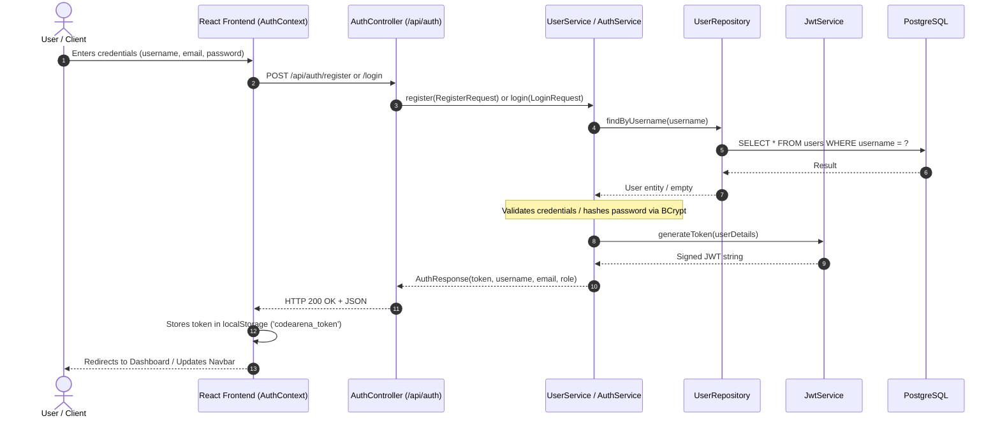
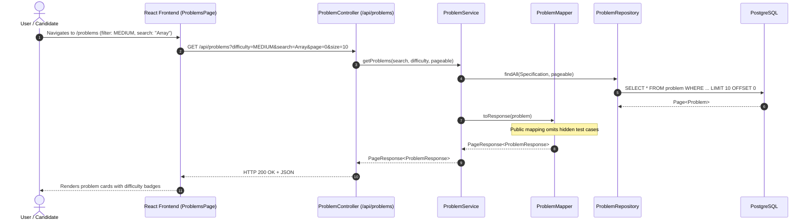
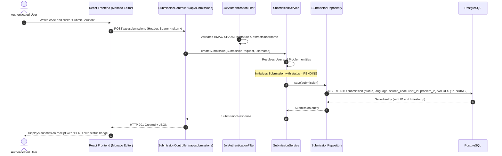
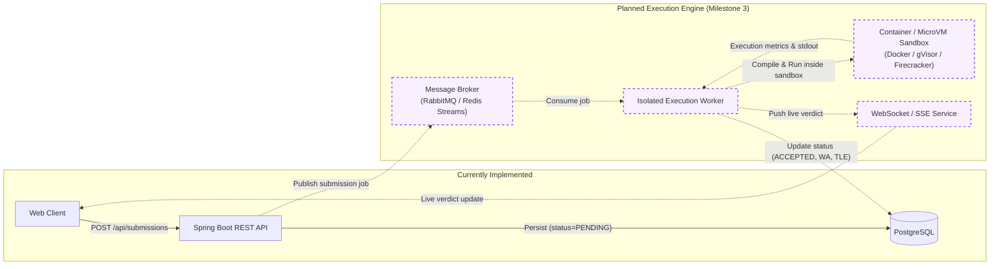

# CodeArena — Architecture & System Design Documentation

This document describes the architectural design, component interactions, security model, and data flow of **CodeArena**, a full-stack algorithmic coding platform.

---

## 1. High-Level System Architecture

CodeArena follows a modern **layered, decoupled client-server architecture**:
- **Client Tier:** A single-page application (SPA) built with React, TypeScript, Vite, and Tailwind CSS.
- **API & Security Gateway Tier:** Spring Boot 3 REST API secured with Spring Security 6 and stateless JSON Web Tokens (JWT).
- **Service & Business Tier:** Transactional Spring services orchestrating business rules, DTO mapping, and domain logic.
- **Persistence Tier:** Spring Data JPA with Hibernate ORM backed by PostgreSQL for persistent production data and H2 for isolated automated testing.

```mermaid
flowchart TD
    subgraph Client["Frontend Client (React 18 + TypeScript)"]
        UI["UI Pages & Components<br/>(Dashboard, Problems, Monaco Editor, Submissions)"]
        AxiosClient["Axios API Client<br/>(JWT Interceptor & Error Normalization)"]
        AuthCtx["AuthContext & LocalStorage<br/>(Session & Token Management)"]
        UI --> AxiosClient
        AuthCtx -. Token injection .-> AxiosClient
    end

    subgraph Gateway["API & Security Layer (Spring Boot 3)"]
        CORS["CORS Filter<br/>(Allowed Origins: localhost:*)"]
        SecurityFilterChain["Spring Security 6 FilterChain<br/>(CSRF Disabled, Stateless Session)"]
        JwtFilter["JwtAuthenticationFilter<br/>(Extracts & Validates HMAC-SHA256 Token)"]
        CORS --> SecurityFilterChain --> JwtFilter
    end

    subgraph Controllers["REST Controller Layer"]
        AuthController["AuthController<br/>/api/auth/*"]
        ProblemController["ProblemController<br/>/api/problems/*"]
        SubmissionController["SubmissionController<br/>/api/submissions/*"]
        SwaggerDocs["Swagger / OpenAPI<br/>/swagger-ui/index.html<br/>/v3/api-docs"]
        GlobalException["GlobalExceptionHandler<br/>(RFC 7807 ProblemDetail)"]
    end

    subgraph Services["Service & Business Logic Tier"]
        UserService["UserService / UserServiceImpl<br/>(BCrypt hashing, User lookup)"]
        ProblemService["ProblemService / ProblemServiceImpl<br/>(JPA Specification querying, CRUD)"]
        SubmissionService["SubmissionService / SubmissionServiceImpl<br/>(Intake validation, ownership checks)"]
        JwtService["JwtService<br/>(Token generation & signature verification)"]
        Mapper["ProblemMapper<br/>(Entity <-> DTO conversion, hides hidden test cases)"]
    end

    subgraph Persistence["Persistence & Database Tier"]
        UserRepository["UserRepository"]
        ProblemRepository["ProblemRepository"]
        SubmissionRepository["SubmissionRepository"]
        Seeder["DatabaseSeeder<br/>(Idempotent seeding & Admin bootstrap)"]
        PostgresDB[("PostgreSQL Database<br/>(users, problem, example, test_case, submission)")]
    end

    AxiosClient -->|"HTTP Requests (JSON / Bearer Token)"| CORS
    JwtFilter --> Controllers
    Controllers --> Services
    Services --> Persistence
    UserRepository --> PostgresDB
    ProblemRepository --> PostgresDB
    SubmissionRepository --> PostgresDB
    Seeder --> PostgresDB
```



---

## 2. Component Breakdown

### 2.1 Frontend Client Layer (`frontend/`)

- **Routing & Navigation (`react-router-dom`):**
  - Public routes: `/` (Landing), `/login` (Login), `/register` (Sign Up), `/problems` (Problems list), `/problems/:id` (Problem details).
  - Protected routes (`ProtectedRoute`): `/dashboard` (User dashboard), `/submissions` (Submission history).
- **Interactive Code Editor (`@monaco-editor/react`):**
  - Embeds the VS Code-grade Monaco Editor.
  - Multi-language syntax highlighting and starter code templates for Java, Python, C++, JavaScript, Go, and Rust.
  - Editor settings (tab size, line numbers, mini-map, dark theme `vs-dark`).
- **Axios API Client (`frontend/src/api/client.ts`):**
  - **Request Interceptor:** Automatically reads the active token from `localStorage` (`codearena_token`) and injects the HTTP header:
    ```http
    Authorization: Bearer <jwt-token>
    ```
  - **Response Interceptor:** Gracefully captures `401 Unauthorized` responses, clears stale authentication tokens, and redirects the client to `/login`.
  - **RFC 7807 Parsing:** Normalizes backend `ProblemDetail` payloads (`status`, `detail`, `errors`, `title`) into consistent user-facing error messages.

### 2.2 Security & Authentication Layer

- **Stateless Authentication:** No HTTP sessions or cookies are used. The client maintains its session purely through standard cryptographic JWT Bearer tokens.
- **JWT Architecture (`JwtAuthenticationFilter` & `JwtService`):**
  - Symmetric HMAC-SHA256 signing using a 256-bit secret key (`JWT_SECRET`).
  - Configurable expiration (default: 60 minutes).
  - Subject claim holds the user's unique username; authority claim encodes role membership (`ROLE_USER`, `ROLE_ADMIN`).
- **Password Security:** Passwords are never stored in plaintext. Spring Security's `BCryptPasswordEncoder` (work factor 10) securely hashes passwords prior to database persistence.
- **Role-Based Access Control (RBAC):**
  - `ROLE_USER`: Can view problems, create submissions, and inspect own profile/submissions.
  - `ROLE_ADMIN`: Inherits all user capabilities plus problem creation (`POST /api/problems`), modification (`PUT /api/problems/{id}`), and deletion (`DELETE /api/problems/{id}`).

### 2.3 REST API & Controller Layer

- **Public Endpoints:**
  - `POST /api/auth/register`: Creates new user account, verifies unique username/email, generates and returns token.
  - `POST /api/auth/login`: Validates credentials, returns JWT token with user metadata.
  - `GET /api/problems`: Paginated problem list with optional title/description substring search (`search`) and difficulty filter (`difficulty`).
  - `GET /api/problems/{id}`: Full problem description, constraints, input/output formats, and public examples.
  - `GET /swagger-ui/index.html` & `GET /v3/api-docs/**`: Interactive Swagger UI documentation.
- **Protected Endpoints:**
  - `GET /api/auth/me`: Retrieves current authenticated user's profile.
  - `POST /api/submissions`: Submits code solution for a problem.
  - `GET /api/submissions/my`: Retrieves all submissions created by the authenticated user, sorted in descending order of submission time.
  - `GET /api/submissions/{id}`: Retrieves a single submission by ID, guarded by ownership verification.
- **Admin-Only Endpoints:**
  - `POST /api/problems`: Creates new problem with examples and test cases.
  - `PUT /api/problems/{id}`: Modifies an existing problem.
  - `DELETE /api/problems/{id}`: Removes a problem and cascades to examples and test cases.

### 2.4 Service & Persistence Layer

- **Data Models & Relationships:**
  - `User`: Holds identity, email, hashed credentials, and role.
  - `Problem`: Contains title, description, difficulty, input/output formats, constraints, and resource limits (time limit in ms, memory limit in MB).
  - `Example`: One-to-many relationship with `Problem` (`CascadeType.ALL`, `orphanRemoval = true`), displaying sample inputs, outputs, and explanations.
  - `TestCase`: One-to-many relationship with `Problem`. Contains input data, expected output, and a boolean `isHidden` flag.
  - `Submission`: Many-to-one with `User` and `Problem`. Stores submitted `sourceCode`, `language`, `status` (`PENDING`), `submittedAt`, and execution metrics.
- **Information Protection:**
  - `ProblemMapper` deliberately omits hidden test cases (`isHidden == true`) when mapping public `ProblemResponse` objects, ensuring test case privacy during problem exploration.
- **Dynamic Querying (`ProblemSpecifications`):**
  - Utilizes Spring Data JPA `Specification` to build dynamic SQL predicates (`LIKE %search%` across title and description, exact match on `difficulty`).

---

## 3. Key Request & Data Flows

### 3.1 Authentication Flow (Register / Login)



### 3.2 Problem Exploration & Detail Retrieval



### 3.3 Code Submission Intake Flow



---

## 4. Current Implemented Scope vs. Planned Execution Engine

It is essential to understand the boundary between what is currently implemented in CodeArena and the planned future phases:

### Currently Implemented
- **Submission Intake & Persistence:** Submissions are validated, stored in PostgreSQL, associated with the submitting user and problem, and given the initial state `PENDING`.
- **Ownership Security:** Users can only retrieve their own submissions; administrators can audit all submissions.
- **Problem Test Case Data:** Test cases (both sample and hidden) are modeled, seeded, and securely stored in PostgreSQL.

### Planned Worker Execution Engine
The current milestone intentionally does not execute submitted code. In a production judge platform, running untrusted user code directly on the application server is a critical security vulnerability. 

The planned architecture for Milestone 3 decouples execution into an isolated asynchronous pipeline:



---

## 5. Security & Isolation Guidelines

1. **Database Secrets:** Never hardcode database credentials. CodeArena reads `DB_PASSWORD` and `JWT_SECRET` from environment variables with fallback to empty strings.
2. **Stateless Security:** Disabling HTTP sessions ensures scalability and prevents session fixation attacks.
3. **CORS:** Restricted to trusted local development origins (`http://localhost:5173`, `http://localhost:3000`).
4. **Data Isolation:** Automated tests execute against an isolated in-memory H2 database with dynamic `create-drop` schema recreation, ensuring no test data pollutes PostgreSQL.
