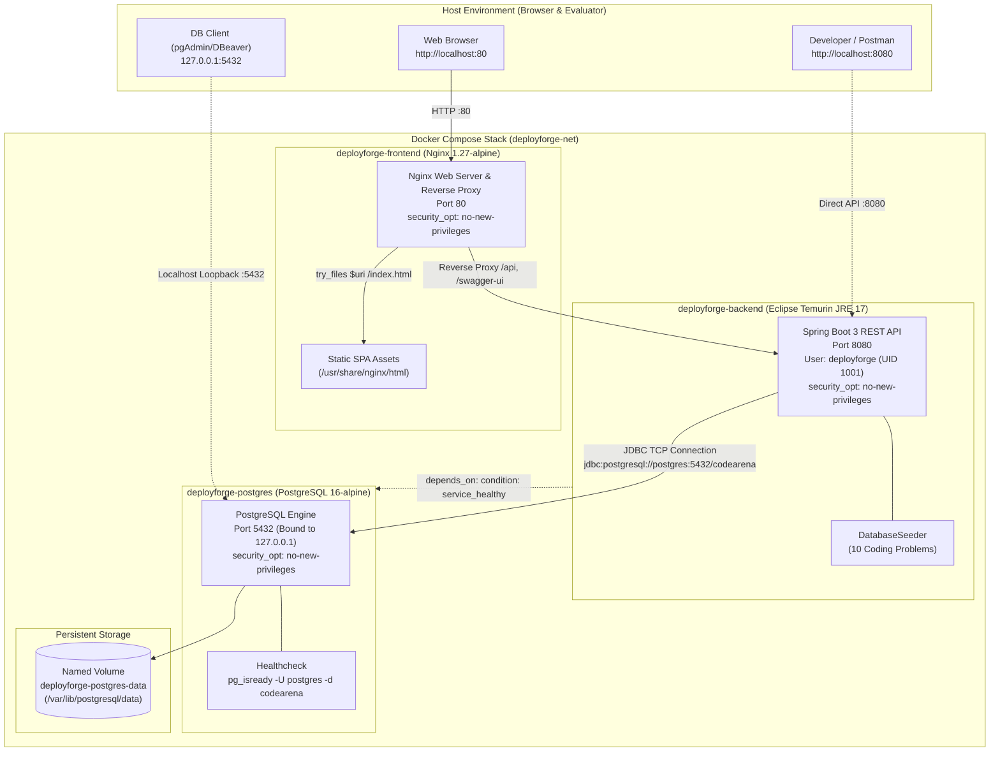
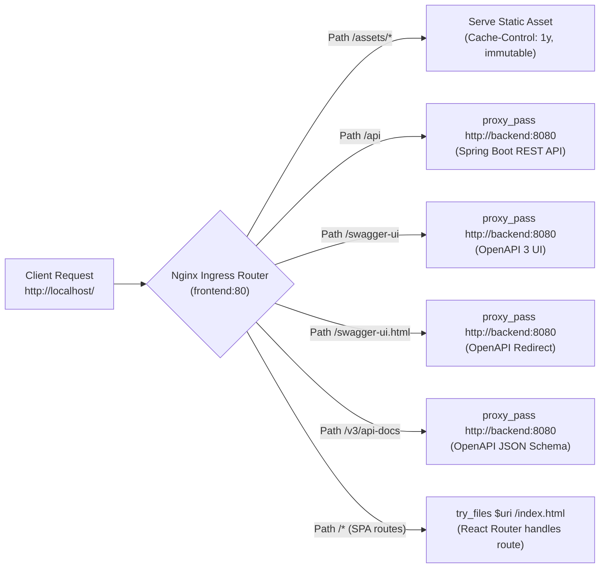
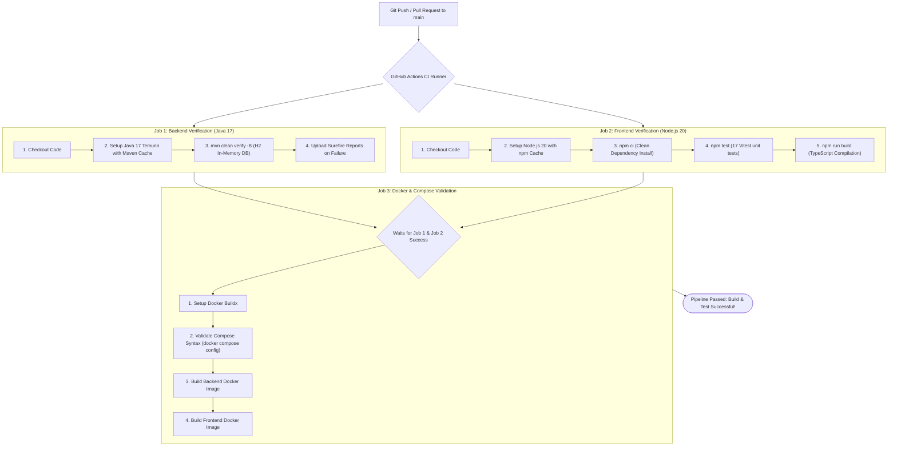

# DeployForge — DevOps Automation & Container Orchestration for CodeArena

**Project Name:** DeployForge
**Course Context:** College DevOps & Cloud Computing Project Submission
**Target Application:** CodeArena (Full-Stack Algorithmic Coding Platform)
**Authors / Maintainers:** DeployForge Engineering Team

---

> [!IMPORTANT]
> **Implementation & Live Deployment Status:**
> - **Live Docker Deployment Confirmed:** Successfully deployed, orchestrated, and verified with Docker Desktop (WSL 2 Linux engine). All 3 containers (`deployforge-postgres`, `deployforge-backend`, `deployforge-frontend`) are running and report `(healthy)`.
> - **End-to-End Edge Proxy Verified:** Nginx reverse-proxies `/api` and `/swagger-ui` cleanly to Spring Boot. Endpoints tested and working: frontend UI (200 OK), public problems catalogue (10 seeded problems returned), Swagger UI / OpenAPI docs (200 OK), user login/registration (JWT issued), Run Code execution against sample cases (200 OK, ACCEPTED), and full Submission evaluation workflow against test cases with live status updates (ACCEPTED, WRONG_ANSWER, COMPILATION_ERROR, TIME_LIMIT_EXCEEDED, RUNTIME_ERROR).
> - **Locally Verified on Host:** Spring Boot 3 backend test suite (68/68 tests passing in JUnit 5 & Mockito), React 18 frontend test suite (19/19 tests passing via Vitest), and production Vite bundle compilation directly verified with zero failures.

---

## 1. Executive Summary & Problem Statement

### 1.1 The Challenge
Modern web applications, especially multi-tier platforms like CodeArena (Spring Boot, React/Vite, and PostgreSQL), often suffer from the **"works on my machine"** dilemma. Deploying such applications manually involves complex local environment configuration: provisioning PostgreSQL databases, managing conflicting Java and Node.js SDK versions, handling network port clashes, and configuring CORS rules. Furthermore, without automated Continuous Integration (CI), code regressions go undetected until late in the delivery cycle.

### 1.2 The DeployForge Solution
**DeployForge** packages and automates CodeArena into an isolated, containerized, and automated DevOps architecture. DeployForge introduces:
1. **Multi-Stage Dockerization:** Creating isolated build stages that separate compilation dependencies from minimal runtime environments for both Spring Boot and React.
2. **Declarative Service Orchestration:** Using **Docker Compose** to coordinate PostgreSQL 16, the Spring Boot API, and Nginx edge web server over an internal software-defined bridge network (`deployforge-net`).
3. **Healthcheck-Driven Dependency Sequencing:** Utilizing database readiness probes (`pg_isready`) with `condition: service_healthy` so the backend waits until PostgreSQL is fully accepting connections before booting.
4. **Edge Reverse Proxying via Nginx:** An Nginx web server that serves pre-compiled SPA assets, implements client-side fallback routing (`try_files`), applies Gzip compression, injects HTTP security headers, and reverse-proxies `/api` and Swagger documentation traffic to the backend.
5. **Automated Continuous Integration (CI):** A zero-cost **GitHub Actions** pipeline verifying backend tests, frontend tests, production bundle building, and Docker image validation on every push and pull request to `main`.

---

## 2. Project Objectives

- [x] **Containerize Backend:** Author a multi-stage Dockerfile packaging Spring Boot 3 on Eclipse Temurin 17 Alpine running as a non-root user (`deployforge`).
- [x] **Containerize Frontend:** Author a multi-stage Dockerfile compiling TypeScript/React via Vite and serving via Nginx Alpine.
- [x] **Orchestrate Multi-Tier Stack:** Configure Docker Compose to launch PostgreSQL 16, Spring Boot API, and Nginx frontend with a single command: `docker compose up --build`.
- [x] **Eliminate Startup Race Conditions:** Implement PostgreSQL healthcheck probes (`pg_isready`) so the backend boots only when the database is healthy.
- [x] **Automate CI Testing:** Establish a GitHub Actions pipeline validating backend tests (68 passing tests), frontend tests (19 passing tests), and Dockerfile validity on branch pushes.
- [x] **Eliminate Credential Hardcoding:** Standardize all configuration through environment variables with safe defaults and a documented `.env.example` template.
- [x] **Document Academic Walkthrough:** Provide clear architecture diagrams, step-by-step setup guides, troubleshooting steps, and exact evaluation walkthroughs for academic demonstration.

---

## 3. Technology Stack

| Layer | Component | Version | Role in DeployForge |
| :--- | :--- | :--- | :--- |
| **CI / CD Pipeline** | GitHub Actions | Standard Runner (`ubuntu-latest`) | Automated build, test, and Docker validation matrix |
| **Container Engine** | Docker Engine & CLI | 24+ / Compose v2 | Multi-stage container packaging and image layering |
| **Container Orchestration** | Docker Compose | Compose Spec | Multi-service lifecycle management and volume mapping |
| **Reverse Proxy & Web Server** | Nginx | 1.27-alpine | Edge gateway, SPA routing fallback, Gzip compression, API proxy |
| **Application Runtime** | Eclipse Temurin JRE | 17-jre-alpine | Minimal Java Virtual Machine container runtime |
| **Application Framework** | Spring Boot | 3.3.5 | Backend RESTful API, Spring Security 6, JPA Hibernate |
| **Database Tier** | PostgreSQL | 16-alpine | ACID-compliant relational persistence |
| **Frontend Framework** | React 18 / Vite 6 | TypeScript 5.6 | Single-Page Application (SPA) client interface |
| **Build Automation** | Apache Maven / npm | Maven 3.9 / Node 20 | Dependency management and artifact packaging |

---

## 4. DevOps Architecture & Container Topology



---

## 5. Multi-Stage Docker Build Strategies

### 5.1 Backend Multi-Stage Build (`Dockerfile`)
Building Java applications in Docker often yields bloated images when Maven and full JDK compilers are retained in the final runtime container. DeployForge applies a **two-stage build pipeline**:

1. **Stage 1 (Builder):** Uses `maven:3.9.9-eclipse-temurin-17-alpine`.
   - Copies `pom.xml` first and invokes `mvn dependency:resolve -B` to download dependencies into a cached Docker layer.
   - Copies `src/` and runs `mvn clean package -DskipTests -B`.
2. **Stage 2 (Runner):** Uses `eclipse-temurin:17-jre-alpine`.
   - Creates a dedicated non-root user `deployforge` (UID 1001, GID 1001).
   - Copies only the compiled executable JAR (`codearena-0.0.1-SNAPSHOT.jar`) from the builder stage.
   - Discards all compilers, source files, and Maven local repositories.
   - Configures optimized JVM runtime flags (`-Xms256m -Xmx512m -XX:+UseG1GC -Djava.security.egd=file:/dev/./urandom`).
   - Declares an automated `HEALTHCHECK` probing the REST API.

### 5.2 Frontend Multi-Stage Build (`frontend/Dockerfile`)
Development environments require Node.js runtimes, package managers, and developer tools (`devDependencies`) that are unnecessary in production.

1. **Stage 1 (Builder):** Uses `node:20-alpine`.
   - Copies `package.json` and `package-lock.json`.
   - Executes `npm ci` for deterministic, clean package installation.
   - Compiles TypeScript and runs `npm run build` using Vite. Output generated in `/app/dist`.
2. **Stage 2 (Runner):** Uses `nginx:1.27-alpine`.
   - Copies only the compiled HTML, CSS, JavaScript, and SVG bundles to `/usr/share/nginx/html`.
   - Deploys custom Nginx configuration (`nginx.conf`).
   - Discards Node.js runtime, npm cache, and `node_modules`.

---

## 6. Nginx Edge Routing & Reverse Proxy Architecture

The frontend Nginx container serves as the edge gateway for end users:



### Key Routing & Security Features:
- **Consistent URI Forwarding (`location /api`):** Uses standard prefix matching passing directly to `http://backend:8080`, preserving API routes (`/api/problems`, `/api/auth/login`, `/api/submissions`) without trailing slash ambiguity.
- **Swagger Documentation Support:** Explicitly proxies `/swagger-ui`, `/swagger-ui.html`, and `/v3/api-docs` to allow API documentation exploration through the frontend host.
- **Client-Side SPA Routing (`try_files $uri $uri/ /index.html`):** Prevents HTTP 404 errors when users refresh deep React routes (e.g., `/problems/1`, `/dashboard`, `/submissions`).
- **Gzip Compression:** Automatically compresses text, JSON, CSS, and JS payloads over 1 KB.
- **Security Hardening:** Injects `X-Frame-Options: SAMEORIGIN`, `X-Content-Type-Options: nosniff`, `X-XSS-Protection: 1; mode=block`, and `Referrer-Policy: strict-origin-when-cross-origin`.

---

## 7. Container Orchestration & Health-Driven Sequencing

DeployForge avoids startup race conditions natively in [`docker-compose.yml`](docker-compose.yml):

```yaml
  postgres:
    image: postgres:16-alpine
    healthcheck:
      test: ["CMD-SHELL", "pg_isready -U ${POSTGRES_USER:-postgres} -d ${POSTGRES_DB:-codearena}"]
      interval: 5s
      timeout: 5s
      retries: 5
      start_period: 10s

  backend:
    build:
      context: .
      dockerfile: Dockerfile
    depends_on:
      postgres:
        condition: service_healthy
```

1. **`postgres` container starts** and initializes storage on the `deployforge-postgres-data` named volume.
2. The healthcheck periodically executes `pg_isready` against port 5432.
3. Docker Compose delays the `backend` container startup until `postgres` reports `healthy`.
4. Once healthy, `backend` boots, connects to `jdbc:postgresql://postgres:5432/codearena`, runs JPA schema migrations, and executes `DatabaseSeeder` to insert 10 coding problems and bootstrap the administrator account.
5. `frontend` starts and begins serving web traffic on port 80.

---

## 8. Continuous Integration (CI) Pipeline with GitHub Actions

The automated workflow located at [`.github/workflows/ci.yml`](.github/workflows/ci.yml) triggers on every push and pull request to `main`:



### Pipeline Guarantees:
- **No External Test Database Required:** Automated backend tests use an isolated H2 database; no external database server is needed on the CI runner.
- **Fail-Fast Safety:** If any backend or frontend test fails, Docker image builds are skipped, saving CI runner minutes.
- **Multi-Stage Build Verification:** Confirms that both multi-stage Dockerfiles compile cleanly and that `docker-compose.yml` has valid syntax against `.env.example`.

---

## 9. Local Deployment & Execution Guide

### 9.1 Docker Desktop Installation Prerequisites (Windows 11)
To run Docker Compose on Windows:
1. Ensure hardware virtualization is enabled in your machine's BIOS/UEFI.
2. Ensure WSL 2 is installed. In an Administrator PowerShell terminal, run:
   ```powershell
   wsl --install
   ```
3. Download and install **[Docker Desktop for Windows](https://www.docker.com/products/docker-desktop/)**.
4. During installation, select **"Use WSL 2 instead of Hyper-V"**.
5. Launch Docker Desktop and verify the installation in PowerShell:
   ```powershell
   docker --version
   docker compose version
   ```

### 9.2 Step 1: Clone the Repository
```bash
git clone https://github.com/vidushitripa4thi/codearena.git
cd codearena
```

### 9.3 Step 2: Configure Environment Variables
Copy the provided `.env.example` template:
```powershell
# Windows PowerShell:
Copy-Item .env.example .env

# Linux / macOS:
cp .env.example .env
```

### 9.4 Step 3: Launch with Docker Compose
```bash
docker compose up --build
```

To run in detached background mode:
```bash
docker compose up --build -d
```

### 9.5 Step 4: Verify Running Services
```bash
docker compose ps
```

### 9.6 Step 5: Access the Application
- **Frontend Web UI:** [`http://localhost`](http://localhost) (Port 80)
- **Backend REST API:** [`http://localhost:8080/api/problems`](http://localhost:8080/api/problems)
- **Interactive Swagger UI:** [`http://localhost/swagger-ui/index.html`](http://localhost/swagger-ui/index.html) or [`http://localhost:8080/swagger-ui/index.html`](http://localhost:8080/swagger-ui/index.html)
- **Default Admin Account:**
  - Username: `admin`
  - Password: `AdminPassword123!`

---

## 10. Verified Test & Live Deployment Results

### 10.1 Live Docker Container Deployment Status (`docker compose ps`)
```text
NAME                   IMAGE                COMMAND                  SERVICE    STATUS                    PORTS
deployforge-backend    codearena-backend    "sh -c 'java $JAVA_O…"   backend    Up 3 minutes (healthy)    0.0.0.0:8080->8080/tcp, [::]:8080->8080/tcp
deployforge-frontend   codearena-frontend   "/docker-entrypoint.…"   frontend   Up 3 minutes (healthy)    0.0.0.0:80->80/tcp, [::]:80->80/tcp
deployforge-postgres   postgres:16-alpine   "docker-entrypoint.s…"   postgres   Up 3 minutes (healthy)    127.0.0.1:5433->5432/tcp
```

### 10.2 Real Measured Docker Image Metrics (`docker images`)
| Image Name | Tag | Disk Usage | Content Size | Runtime Environment |
| :--- | :--- | :--- | :--- | :--- |
| `codearena-backend` | `latest` | 373 MB | **123 MB** | Minimal Eclipse Temurin JRE 17 Alpine |
| `codearena-frontend` | `latest` | 74.1 MB | **21.1 MB** | Minimal Nginx 1.27 Alpine |
| `postgres` | `16-alpine` | ~380 MB | ~112 MB | Official PostgreSQL 16 Alpine |

### 10.3 Live Endpoint Verification Matrix
| Endpoint | Method | Through Gateway | Status | Result / Content Verified |
| :--- | :--- | :--- | :--- | :--- |
| `http://localhost/` | `GET` | Nginx Port 80 | **200 OK** | Serves compiled React 18 SPA (`index.html`) |
| `http://localhost/api/problems` | `GET` | Reverse Proxy | **200 OK** | Returns 10 seeded coding problems (`totalElements: 10`) |
| `http://localhost/swagger-ui/index.html` | `GET` | Reverse Proxy | **200 OK** | Interactive Swagger UI loaded |
| `http://localhost/v3/api-docs` | `GET` | Reverse Proxy | **200 OK** | OpenAPI 3.0.0 specification with 8 API paths |
| `http://localhost/api/auth/login` | `POST` | Reverse Proxy | **200 OK** | Authenticated admin user, issued 256-bit JWT |
| `http://localhost/api/auth/register` | `POST` | Reverse Proxy | **200 OK** | Registered new student user, role `USER` |
| `http://localhost/api/submissions/run` | `POST` | Reverse Proxy | **200 OK** | Real-time code execution against sample test cases (ACCEPTED, 59ms); rejects malicious code (COMPILATION_ERROR) |
| `http://localhost/api/submissions` | `POST` | Reverse Proxy | **201 Created** | Real-time evaluation against test cases; persists verdict (ACCEPTED, WA, TLE, RE, CE) |
| `http://localhost/api/submissions/my` | `GET` | Reverse Proxy | **200 OK** | Returns user's persistent submission history from PostgreSQL |

### 10.4 Automated Backend Test Suite (`mvn test`)
- **Status:** **BUILD SUCCESS**
- **Execution Time:** **29.467 seconds**
- **Results:** **68 tests executed, 68 PASSED, 0 failures, 0 errors, 0 skipped**
  - `DatabaseSeederTest`: 6 tests passed (idempotent seeding, test cases, admin bootstrap)
  - `JwtAuthenticationFilterTest`: 3 tests passed (Bearer token extraction, validation)
  - `AuthControllerTest`: 3 tests passed (registration, login, profile retrieval)
  - `ProblemControllerTest`: 4 tests passed (problem listing, search, filtering)
  - `SubmissionControllerTest`: 4 tests passed (runCode endpoint, submission intake, ownership verification)
  - `ProblemRepositoryTest`: 1 test passed (JPA query specification)
  - `SecurityIntegrationTest`: 17 tests passed (JWT auth, role-based access control, Swagger access)
  - `CodeExecutionServiceTest`: 7 tests passed (syntax check, simple solution, wrong answer, generate parentheses, security policy violations: System.exit, ProcessBuilder, Socket)
  - `OutputComparatorTest`: 5 tests passed (exact match, booleans, numeric equality, list/JSON arrays, multiset permutations)
  - `ProblemServiceImplTest`: 4 tests passed (CRUD logic, DTO mapping)
  - `SubmissionServiceImplTest`: 7 tests passed (runCode against examples, submission evaluation against test cases)
  - `UserServiceImplTest`: 7 tests passed (password hashing, user accounts)

### 10.5 Automated Frontend Test Suite (`npm test` in `frontend/`)
- **Framework:** Vitest 2.1 + React Testing Library + JSDOM
- **Execution Time:** **12.81 seconds**
- **Results:** **4 test files passed, 19 tests executed, 19 PASSED, 0 failures**
  - `AuthFlow.test.tsx`: 6 tests passed (login, registration validation, token persistence, error handling)
  - `ProblemsPage.test.tsx`: 4 tests passed (problem catalog rendering, search, filters)
  - `ProblemDetailPage.test.tsx`: 6 tests passed (specifications rendering, sign-in prompt, Run Code execution, compilation errors, test case tabs)
  - `SubmissionsPage.test.tsx`: 3 tests passed (submission list table, status badge rendering)

### 10.6 Production Frontend Compilation (`npm run build` in `frontend/`)
- **TypeScript:** Strict typecheck passed with zero errors (`tsc` clean).
- **Vite:** Production asset bundle generated in **5.83 seconds** (`dist/assets/index-DMMsqc-u.css`: 29.02 kB, `dist/assets/index-BlfwC8A4.js`: 328.56 kB).

---

## 11. Demonstration Walkthrough for College Evaluation

Follow these steps during your project viva or lab demonstration:

1. **Source Code & DevOps Architecture:**
   - Walk through the multi-stage build design in [`Dockerfile`](Dockerfile) and [`frontend/Dockerfile`](frontend/Dockerfile), explaining how compilers and package managers are discarded from runtime containers.
   - Walk through [`frontend/nginx.conf`](frontend/nginx.conf) and explain how `/api` and `/swagger-ui` are reverse-proxied internally to avoid CORS issues.
2. **Show Healthcheck Dependency Sequencing:**
   - Point out `depends_on: postgres: condition: service_healthy` in [`docker-compose.yml`](docker-compose.yml) and explain why `pg_isready` prevents database connection crashes on startup.
3. **Demonstrate Automated CI Validation:**
   - Show [`.github/workflows/ci.yml`](.github/workflows/ci.yml) and explain the 3-job pipeline (Backend tests $\rightarrow$ Frontend tests $\rightarrow$ Docker verification).
   - Execute `mvn test` in terminal to demonstrate **68 backend tests passing**.
   - Execute `npm test` in the `frontend` directory to demonstrate **19 frontend tests passing**.
   - Execute `npm run build` to demonstrate production TypeScript compilation.
4. **Demonstrate Container Orchestration:**
   - Run `docker compose up -d`.
   - Open browser at `http://localhost`, log in with `admin` / `AdminPassword123!`, browse challenges, submit code, and open Swagger UI.
5. **Demonstrate Live Code Execution & Judging:**
   - Open *Generate Parentheses* (`/problems/10`).
   - Click **Run Code**: show sample test case 1 and 2 evaluated live with execution time and green checkmarks.
   - Click **Submit Solution**: show submission recorded in PostgreSQL with verdict `ACCEPTED`.
   - Introduce a syntax error (e.g., delete a semicolon): click Submit and show `COMPILATION_ERROR`.
   - Introduce a security violation (e.g., `System.exit(0)`): show the security policy rejection.
6. **Demonstrate Persistent Volumes:**
   - Check submission history on `/submissions`.
   - Restart the stack with `docker compose restart`. Show that data persists via the `deployforge-postgres-data` volume.

---

## 12. Screenshots Required for NIET Demonstration

Capture the following screenshots to include in your project report, slide deck, and presentation dossier:

| # | Screenshot Title | Location / Command | Purpose |
| :-: | :--- | :--- | :--- |
| **1** | **Docker Containers Status** | Docker Desktop UI or `docker compose ps` | Proves all 3 services (`postgres`, `backend`, `frontend`) are running and report `(healthy)`. |
| **2** | **Nginx Reverse Proxy & Landing Page** | Browser at `http://localhost/` | Demonstrates the single edge port 80 entry point serving the React application. |
| **3** | **Problems Library Catalog** | Browser at `http://localhost/problems` | Shows 10 original coding problems with difficulty badges (Easy, Medium, Hard). |
| **4** | **Problem Workspace & Monaco Editor** | Browser at `http://localhost/problems/10` | Shows the split view with problem constraints, examples, and VS Code-grade code editor. |
| **5** | **"Run Code" Live Execution Results** | Browser at `/problems/10` (after Run Code) | Demonstrates sample test cases evaluation, execution time (59ms), and passed badges. |
| **6** | **"Submit Solution" Accepted Verdict** | Browser at `/problems/10` (after Submit) | Shows full test case evaluation, submission ID, memory used, and ACCEPTED status. |
| **7** | **Compilation Error & Diagnostics** | Browser at `/problems/10` (with syntax error) | Proves error feedback displays compiler line number and error details. |
| **8** | **Submissions History Table** | Browser at `http://localhost/submissions` | Displays the persistent record of all verdicts (Accepted, Wrong Answer, TLE, Compile Error). |
| **9** | **Swagger / OpenAPI Documentation** | Browser at `http://localhost/swagger-ui/index.html` | Demonstrates interactive REST API documentation reverse-proxied through Nginx. |
| **10** | **Backend Unit & Integration Test Suite** | Terminal: `mvn test` | Displays `BUILD SUCCESS` with all 68 tests passing and zero failures. |
| **11** | **Frontend Unit Test Suite** | Terminal: `npm test` in `frontend/` | Displays Vitest summary with all 19 tests passing across all 4 test files. |
| **12** | **GitHub Actions CI Pipeline Workflow** | VS Code / GitHub: `.github/workflows/ci.yml` | Proves automated continuous integration pipeline specification. |

---

## 12. Troubleshooting Guide

| Issue / Symptom | Root Cause | Solution |
| :--- | :--- | :--- |
| **`docker: command not found`** | Docker Desktop or CLI is not installed on the host. | Follow [Docker Prerequisites](#91-docker-desktop-installation-prerequisites-windows-11) to install Docker Desktop. |
| **Port 5432 or 8080 already in use** | A local PostgreSQL or Tomcat process is running on the host machine. | Either stop the host service (`net stop postgresql-x64-16`) or change the mapped port in `.env` (e.g., `POSTGRES_PORT=5433`, `BACKEND_PORT=8081`). |
| **Backend fails with `Connection refused`** | Backend started before PostgreSQL was ready. | Verify `docker-compose.yml` includes `depends_on: postgres: condition: service_healthy`. |
| **Frontend displays 502 Bad Gateway** | Nginx cannot reach the backend service. | Verify backend container is running on the shared bridge network (`deployforge-net`). |
| **JWT verification fails on startup** | `JWT_SECRET` is shorter than 256 bits (32 characters). | Ensure `JWT_SECRET` in `.env` is at least 32 characters long. |

---

## 13. Limitations & Future DevOps Roadmap

- [ ] **Kubernetes Manifests (K8s):** Author Helm charts or Kubernetes Deployment and Service manifests for Minikube/EKS.
- [ ] **Observability & Metrics:** Integrate Prometheus for metrics collection and Grafana dashboards monitoring JVM heap and container CPU usage.
- [ ] **Infrastructure as Code (IaC):** Add Terraform scripts to provision cloud infrastructure on AWS or GCP.
- [ ] **Automated Container Vulnerability Scanning:** Incorporate Trivy or Snyk container security scanners into the CI pipeline.
